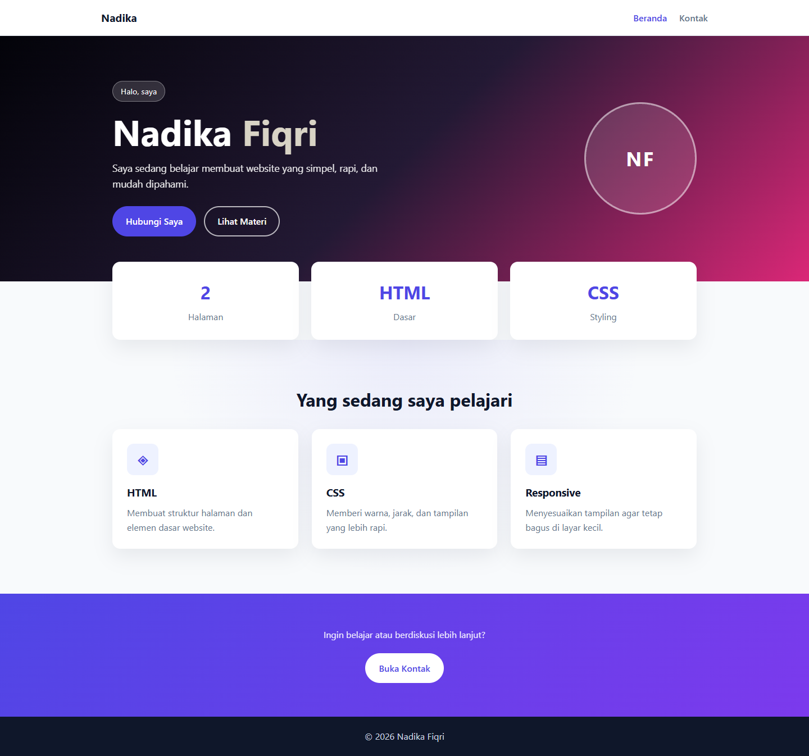
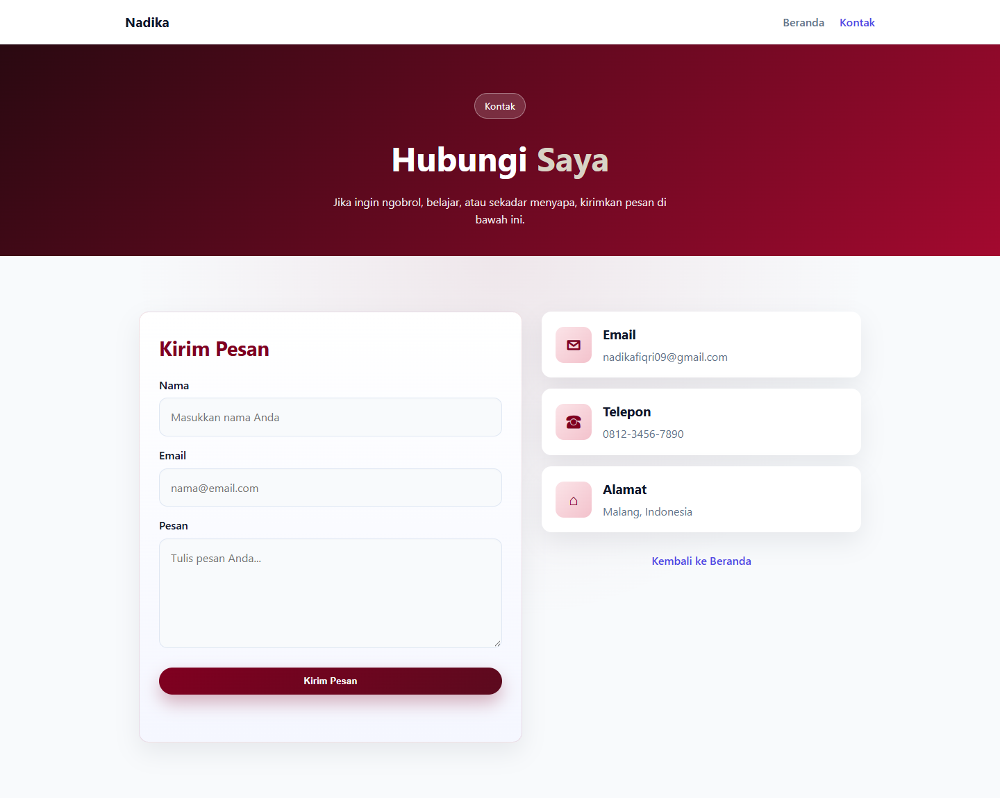

# Website Portofolio Nadika Fiqri

Website portofolio sederhana yang terdiri dari **2 halaman** — Beranda dan Kontak — dibangun menggunakan **HTML, CSS, JavaScript**, dan terintegrasi dengan **API Web3Forms** sehingga pesan dari form kontak langsung terkirim ke email.

## 📸 Screenshot

### Halaman Beranda



### Halaman Kontak



## ✨ Fitur

- **2 halaman** — Beranda dan Kontak dengan navigasi yang konsisten
- **Desain responsive** — tampilan menyesuaikan layar kecil (mobile) melalui media query
- **Form kontak terintegrasi API** — mengirim pesan langsung ke email via Web3Forms
- **Validasi form** — di sisi HTML (`required`, `type="email"`) dan JavaScript (format email)
- **Status pengiriman** — pesan berhasil/gagal ditampilkan, tombol nonaktif saat proses kirim
- **Penanganan error** — koneksi gagal dan respons API gagal ditangani dengan baik

## 🛠️ Teknologi

| Teknologi | Kegunaan |
|---|---|
| HTML5 | Struktur halaman yang semantik |
| CSS3 | Styling, Flexbox, Grid, dan responsive |
| JavaScript (ES6) | Interaksi, validasi form, dan `fetch` API |
| Web3Forms API | Pengiriman pesan form kontak ke email |

## 📁 Struktur Proyek

```
tugas-web/
├── index.html          # Halaman Beranda
├── halaman2.html       # Halaman Kontak
├── style.css           # Semua styling website
├── script.js           # Logika form kontak + integrasi API
├── screenshots/
│   ├── beranda.png     # Screenshot halaman Beranda
│   └── kontak.png      # Screenshot halaman Kontak
└── README.md
```

## 🚀 Menjalankan Secara Lokal

1. Clone repository:

   ```bash
   git clone https://github.com/Nadikafiqri/tugas-web.git
   ```

2. Masuk ke folder proyek:

   ```bash
   cd tugas-web
   ```

3. Buka `index.html` langsung di browser, atau jalankan server lokal:

   ```bash
   python -m http.server 8000
   ```

4. Akses `http://localhost:8000` di browser.

> **Catatan:** form kontak memerlukan koneksi internet karena mengirim data ke API Web3Forms.

## 🔑 Konfigurasi Form Kontak

Form kontak memakai Web3Forms dengan `access_key` yang terdaftar di `script.js`. Untuk memakai email penerima sendiri:

1. Daftar gratis di [web3forms.com](https://web3forms.com)
2. Salin **Access Key** dari dashboard
3. Ganti nilai `access_key` di dalam `script.js`


